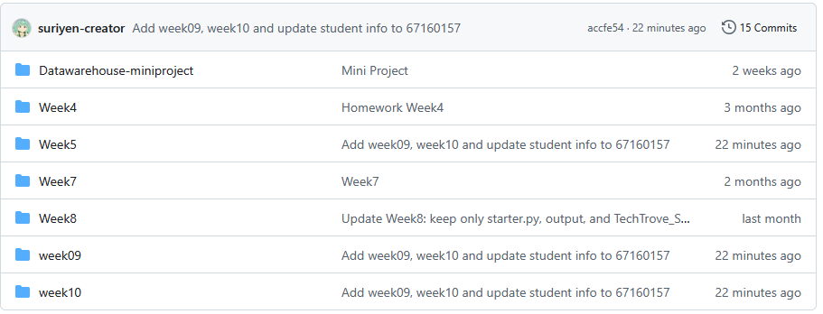

# Data Warehousing & Business Intelligence Coursework

คลังรวบรวมแบบฝึกหัด รายงานปฏิบัติการ และโครงงาน Mini Project รายวิชา **Data Warehouse & Business Intelligence**

---

## 👤 ข้อมูลผู้จัดทำ (Student Profile)

- **ชื่อ-นามสกุล:** นายสุริเยนทร์ กงทิพย์
- **รหัสนิสิต:** 67160157
- **คณะวิทยาการสารสนเทศ มหาวิทยาลัยบูรพา**

---

## 📸 ภาพรวมการส่งงานและ Commit History



---

## 📂 โครงสร้างและเนื้อหาใน Repository (Repository Structure)

| โฟลเดอร์ | รายละเอียด / หัวข้อการเรียนรู้ | เทคโนโลยีที่ใช้ |
| :--- | :--- | :--- |
| [📁 Datawarehouse-miniproject](./Datawarehouse-miniproject) | โครงงาน Mini Project: AI Vision Quality Control DW & BI Dashboard สำหรับตรวจสอบชิ้นส่วนยานยนต์ | Python, SQLite, HTML5, CSS3, JavaScript |
| [📁 Week4](./Week4) | Data Extraction, Transformation and Loading (ETL) เข้าสู่ Star Schema | Python, SQLite, Pandas |
| [📁 Week5](./Week5) | Data Quality & Data Cleaning 6 มิติ และการจัดการ Outliers | Jupyter Notebook (`67160157`), Pandas |
| [📁 week6](./week6) | ETL Pipeline Construction, Data Quality Validation & Star Schema Loading | Python, SQLite, Pandas, JSON |
| [📁 Week7](./Week7) | Python Data Pipeline Engineering, Quarantine System & Deduplication | Python, SQLite, Logging, Batch ETL |
| [📁 Week8](./Week8) | TechTrove E-Commerce: Multi-source Data Integration Pipeline (CRM, JSON, Excel, CSV) | Python, Pandas, OpenPyXL, Word |
| [📁 week09](./week09) | OLTP vs OLAP Architecture, Star Schema SQL Queries (q01-q12) และ Pivot Table Analysis | SQLite, SQL, Pandas, Excel, Markdown |
| [📁 week10](./week10) | Dimensional Modeling & Aggregation Warehouse Practice Lab | MS Word (`Lab-week-10.docx`), SQL |

---

## 🌟 จุดเด่นของผลงานสำคัญ (Key Highlights)

### 1. [Data Warehouse Mini Project](./Datawarehouse-miniproject)
- **ระบบคลังข้อมูลและแดชบอร์ด:** ระบบตรวจสอบตำหนิชิ้นส่วนยานยนต์ (Automotive Bolt Fastener) แบบอัตโนมัติด้วย AI Anomaly Detection
- **Business Intelligence Dashboard:** ออกแบบตามหลัก Executive Storytelling พร้อม Metrics สำคัญ (PPM Slip Rate, Inspection Cycle Time, Cost Savings & ROI Payback)
- **สถาปัตยกรรมข้อมูล:** สอดคล้องตามมาตรฐานยานยนต์ IATF 16949

### 2. [Week 9: OLTP, OLAP & Pivot Table](./week09)
- เปรียบเทียบสถาปัตยกรรมธุรกรรม (OLTP) กับสถาปัตยกรรมการวิเคราะห์ (OLAP)
- คำสั่งวิเคราะห์ข้อมูลแบบเจาะลึกผ่าน SQL (Drill-down, Roll-up, Slice & Dice) ทั้งหมด 12 แบบสอบถาม
- การสร้าง Pivot Table วิเคราะห์ยอดขายและแนวโน้มด้วย Python Pandas

### 3. [Week 7 & 8: Data Integration & Pipeline Engineering](./Week7)
- ออกแบบระบบดักจับข้อมูลผิดปกติลงตาราง **Quarantine** พร้อมระบุ Reason Code
- ผสานรวมข้อมูลดิบหลากฟอร์แมต (CSV, JSON, Excel, Relational DB) เพื่อสร้าง Master Dimension และ Fact Table ที่สมบูรณ์

---

## 🛠️ ความต้องการของระบบ (Prerequisites)

- Python 3.9+
- ไลบรารีหลัก:
  ```bash
  pip install pandas numpy sqlite3 openpyxl jupyter
  ```
